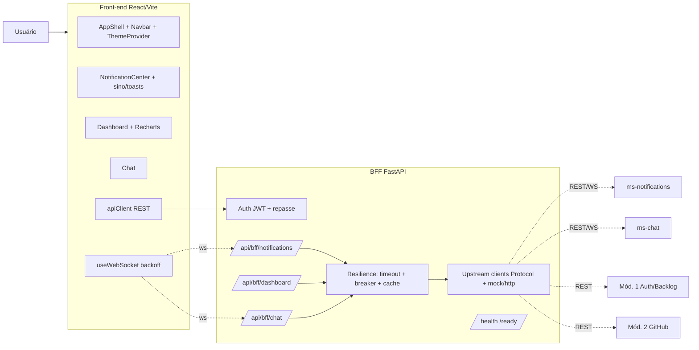

# Design — MVP do `ms-dashboard` (Módulo 6)

## Visão geral

O `ms-dashboard` é o **portal web** do Módulo 6 e o **BFF** que agrega dados dos demais
serviços. Ele **não** persiste notificações nem processa eventos — isso é do `ms-notifications`.
Ele **consome** `ms-notifications`, `ms-chat` e os Módulos 1 e 2, agrega para a tela e garante
que a UI continue de pé quando qualquer um deles cai.

Dois processos no deliverable:
- **Front-end** (React + TS + Vite + Tailwind + Recharts): portal, feed/sino de notificações,
  dashboard e UI do chat.
- **BFF** (FastAPI): valida o JWT, agrega métricas, encapsula os contratos dos serviços
  downstream e aplica timeout + circuit breaker + cache (degradação graciosa).

O requisito transversal da disciplina ("a falha de um serviço não derruba o sistema") é o eixo
do design: o BFF nunca propaga a falha de um downstream como erro de página — devolve estado
parcial, e o front-end traduz em "indisponível no momento" apenas na área afetada.

### Mapa requisito → componente

| Requisito | Componente principal |
|-----------|----------------------|
| R1 Portal/layout | `frontend/` (AppShell, ThemeProvider, rotas) |
| R2 Auth | `bff/core/security` + `frontend/auth` |
| R3 Notificações | `frontend/features/notifications` + `bff/notifications` (proxy) |
| R4 Dashboard | `bff/dashboard` (MetricsAggregator + clients) + `frontend/features/dashboard` |
| R5 Chat | `frontend/features/chat` + `bff/chat` (proxy) |
| R6 Resiliência | `bff/core/resilience` (timeout, circuit breaker, cache) |
| R7 Operação | `bff/core/health`, `logging`, `errors`, `docker-compose`, mocks |
| R8 Identidade visual | `frontend/` tokens + Tailwind |
| R9 Qualidade | camadas + `tests/` |

## Arquitetura



Observação: o WebSocket pode ser **proxied pelo BFF** (um ponto único, o BFF reencaminha para
`ms-notifications`/`ms-chat`) ou **direto do front-end** aos serviços. Para o MVP, o BFF expõe
o endpoint WS e, no modo mock, gera os eventos localmente; o ponto de troca para proxy real
fica isolado no `WsBridge`.

### Estrutura de pastas

```
backend/                      # BFF
  app/
    main.py
    core/
      config.py               # Settings (env): USE_MOCKS, URLs dos serviços, JWT, timeouts
      security.py             # valida JWT, get_current_user, require_role, repasse de token
      logging.py              # logs JSON + correlation_id
      errors.py               # formato de erro padronizado
      resilience.py           # timeout + circuit breaker + cache (decorator/helper)
      health.py               # /health, /ready
    notifications/
      router.py               # REST proxy + WS /ws/notifications (via WsBridge)
      service.py              # orquestra chamadas ao NotificationsClient
    dashboard/
      router.py               # GET /api/bff/dashboard
      aggregator.py           # MetricsAggregator (monta cards independentes)
    chat/
      router.py               # REST histórico + WS /ws/chat
      service.py
    clients/
      base.py                 # tipos comuns, erros (UpstreamUnavailable)
      notifications_client.py # Protocol + HttpNotificationsClient + MockNotificationsClient
      chat_client.py          # Protocol + Http + Mock
      backlog_client.py       # Protocol + Http + Mock (Mód. 1)
      github_client.py        # Protocol + Http + Mock (Mód. 2)
    mocks/
      fixtures.py             # dados determinísticos para a demo
  tests/
frontend/
  src/
    main.tsx, App.tsx
    index.css                 # tokens (CSS variables)
    theme/ThemeProvider.tsx
    lib/apiClient.ts
    hooks/useWebSocket.ts      # reconexão backoff + recuperação REST
    auth/                      # armazenamento do token, dev-login
    features/
      notifications/           # NotificationCenter, NotificationCard, bellBadge, toasts
      dashboard/               # Dashboard, MetricCard, WeeklyChart (Recharts)
      chat/                    # ChatRoom, MessageList, Composer
    components/                # Navbar, AppShell, EmptyState, UnavailableState
  tailwind.config.ts
  docker-compose.yml
```

Dependência sempre para dentro: no BFF `router → service/aggregator → client`; no front-end
`feature → hook/apiClient`. Rotas não falam com HTTP externo direto; componentes não embutem
URLs de serviço.

## Componentes e interfaces

### R2 — Auth e repasse

```python
# backend/app/core/security.py
async def get_current_user(creds = Depends(bearer)) -> CurrentUser: ...   # user_id, role, project_ids
def require_role(*roles: Role) -> Callable: ...                           # -> 403
def downstream_headers(user: CurrentUser) -> dict[str, str]: ...          # repassa Authorization / token de serviço
```

- JWT validado com chave de env; `401` para ausente/expirado/inválido, `403` para papel.
- Modo dev: `GET /api/bff/dev/tokens` (só em `APP_ENV=development`) devolve JWTs de PO/PM/Dev.
- O front-end guarda o token (memória + storage) e injeta no `apiClient`; em `401`, redireciona
  para o dev-login (ou tela de login real quando o Módulo 1 existir).

### R6 — Resiliência (base de R3, R4, R5)

```python
# backend/app/core/resilience.py
class UpstreamUnavailable(Exception): ...

async def guarded_call(key: str, coro_factory, *, timeout: float, ttl: float):
    """Executa a chamada com timeout; em sucesso, grava no cache (TTL).
    Em falha/breaker aberto, retorna (value_from_cache, stale=True) se houver cache,
    senão levanta UpstreamUnavailable. Breaker simples por 'key' (N falhas -> aberto por T)."""
```

- Cada client externo é chamado através de `guarded_call`. O resultado é um valor **ou** um
  marcador de indisponibilidade — nunca uma exceção que suba até a rota como `500`.
- Cache em memória (dict com expiração) no MVP; ponto de extensão para Redis isolado aqui.

### R4 — Dashboard (agregação)

```python
class BacklogClient(Protocol):
    async def stories_by_status(self, project_id: str) -> StoriesByStatus: ...
    async def reviews_pending(self, project_id: str) -> int: ...

class GithubClient(Protocol):
    async def weekly_commits_prs(self, project_id: str) -> WeeklySeries: ...
    async def open_prs(self, project_id: str) -> int: ...
```

```python
@dataclass
class DashboardCard:
    key: str                              # commits_week | open_prs | reviews_pending | stories_by_status
    state: Literal["ok", "unavailable"]
    value: Any | None
    stale: bool                           # servido do cache

class MetricsAggregator:
    async def build(self, project_id: str) -> DashboardResponse:
        # monta cada card de forma independente via guarded_call;
        # a falha de um não impede os demais (R4.3)
```

- `USE_MOCKS=true` injeta `MockBacklogClient`/`MockGithubClient` com dados determinísticos
  (números estáveis para a apresentação). Caso contrário, as implementações HTTP reais.
- `GET /api/bff/dashboard?project_id=...` devolve os cards + a série semanal do gráfico.

### R3 — Notificações (consumo)

```python
class NotificationsClient(Protocol):
    async def list(self, user, *, cursor, filters) -> NotificationPage: ...
    async def unread_count(self, user) -> UnreadCount: ...
    async def mark_read(self, user, notif_id) -> None: ...
    async def mark_all_read(self, user) -> None: ...
    def ws_source(self, user) -> AsyncIterator[dict]: ...   # stream do upstream (ou mock)
```

- O BFF expõe REST de proxy (`/api/bff/notifications...`) e um WS `/ws/notifications`. O
  `WsBridge` assina o stream do upstream (ou do mock) e repassa `notification.new` /
  `unread_count` ao cliente conectado.
- Mock: `MockNotificationsClient` emite notificações de exemplo de cada `source` em intervalos,
  cobrindo todas as prioridades, para demonstrar feed + toasts + contador.
- Indisponibilidade (R3.6): se o upstream cai, o REST responde estado "unavailable" e o WS
  simplesmente não emite; o front-end mostra "notificações indisponíveis".

### R5 — Chat (consumo)

```python
class ChatClient(Protocol):
    async def history(self, user, project_id, *, limit) -> list[ChatMessage]: ...
    async def post(self, user, project_id, text) -> ChatMessage: ...
    def ws_source(self, user, project_id) -> AsyncIterator[dict]: ...
```

- REST de histórico + WS `/ws/chat?project_id=...`. Acesso só a projetos no token (R5.1).
- Mock: `MockChatClient` mantém um histórico em memória por projeto e ecoa mensagens enviadas,
  para demonstrar a sala em tempo real sem o `ms-chat`.

### Front-end

- `ThemeProvider` alterna `data-theme` (claro/escuro); persiste a preferência.
- `useWebSocket`: conecta ao WS do BFF, reconecta com backoff exponencial + jitter e, ao
  reconectar, dispara um refetch REST a partir do último cursor (R3.4).
- `NotificationCard`: borda esquerda 4px na cor da prioridade, selo, origem (ícone+rótulo),
  título, resumo, horário relativo — tudo via classes de token (R8/R3.2).
- `Dashboard`: `MetricCard` (número com `.metric`/`tabular-nums`), `WeeklyChart` (Recharts com
  `--chart-1..5`); card renderiza `UnavailableState` quando `state="unavailable"`.
- `Chat`: `ChatRoom` com `MessageList` + `Composer`; `UnavailableState` quando o chat cai.

## Tratamento de erros

- Formato padronizado do BFF: `{ "error": { "code", "message", "correlation_id" } }`.
- `401`/`403` para auth; `422` para parâmetros inválidos; `503` **somente** quando o próprio BFF
  não consegue servir nem cache para uma área solicitada isoladamente — nunca para a página toda.
- Falhas de downstream viram `state="unavailable"` no payload, não erro HTTP de página (R6.2).
- Sem stack trace na resposta (R7.3).

## Observabilidade

- Middleware de `correlation_id` (header ou gerado) propagado nos logs e repassado aos
  downstreams.
- Logger JSON por `LOG_LEVEL`.
- `GET /health` (processo vivo) e `GET /ready` (BFF pronto; não falha se um downstream está fora,
  pois degradação é esperada — `ready` reflete apenas o próprio BFF).

## Estratégia de testes

| Alvo (requisito) | Tipo | Como |
|------------------|------|------|
| Degradação graciosa (R4.3/R6) | unit | client que falha → card `unavailable`; demais OK; cache serve resposta anterior (`stale=true`) |
| Agregação de métricas (R4.1) | unit/integração | mocks → cards e série corretos |
| Auth e papéis (R2) | unit/integração | token válido/expirado/ausente → 200/401; papel errado → 403 |
| Rotas do BFF (R3/R5) | integração | proxy de notificações e chat com `httpx.AsyncClient` + clients mock |
| Reconexão WS (R3.4) | unit (front) | `useWebSocket` reconecta e refaz fetch |
| Prioridade→cor e indisponibilidade (R3.2/R8) | componente (front) | NotificationCard e UnavailableState |

- BFF: `pytest` + `pytest-asyncio` + `httpx`. Front-end: Vitest + Testing Library.

## Decisões e trade-offs

- **BFF em FastAPI** (confirmado): stack unificada da turma, JWT e OpenAPI consistentes.
- **Clients com Protocol + mock** (confirmado): permitem demo isolada e troca para HTTP real
  quando os outros grupos subirem, sem tocar nas rotas/telas.
- **WS via BFF (bridge) no MVP**: um ponto só para o front-end; proxy real para os upstreams é
  o próximo passo, isolado no `WsBridge`.
- **Cache/breaker em memória**: suficiente para uma instância; Redis é extensão isolada.
- **`ready` não depende de downstream**: a disponibilidade do portal não pode ficar refém de um
  serviço de terceiros — isso é exatamente o comportamento de degradação exigido.
